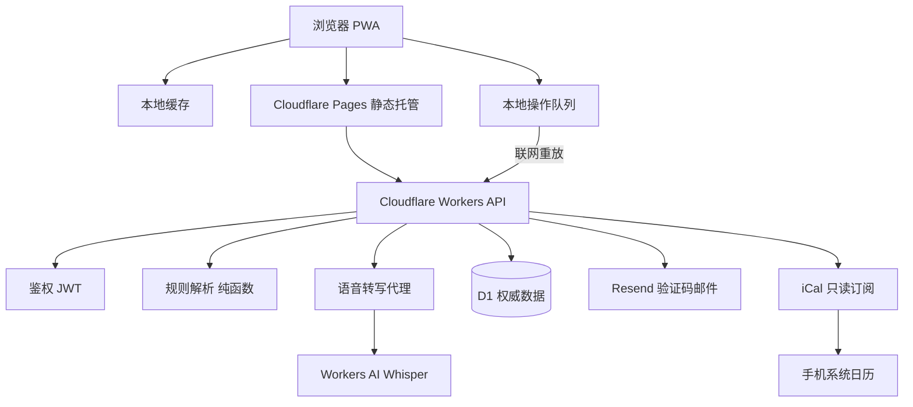
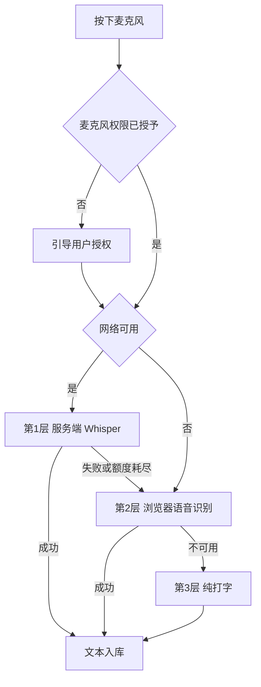
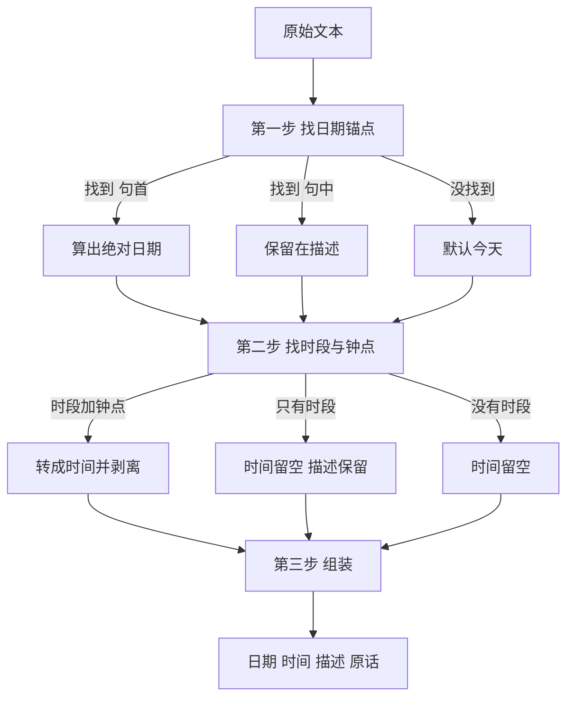

# 菠萝日程 v4.0 产品说明

> 文档版本：v4.0（开发中）
> 基线现状：v3.0.1（2026-08-04），外加 2026-08-31 一次未提交的界面调整
> 写作日期：2026-10-31
> 仓库：`schedule-pro`，main 分支
>
> **实施进度**：八步已于 2026-10-31 全部在本地完成并实跑验证通过，详见表 T24 与表 T25 的"状态"列。**尚未 push 到远端**（按约定：本地做完了统一推）。
>
> **行号基准**：本文所有 `文件:行号` 引用基于 **2026-10-31 第八步实施后的工作区状态**（`workers-api/src/index.js` 约 830 行、`src/app/page.tsx` 约 1,200 行，`src/lib/` 与 `src/components/` 另计）。后续每完成一步实施，需同步校准引用行号。

---

## 一、这份说明是什么

菠萝日程从 v3.0.1 走到 v4.0，要改的不是某几个按钮，是**它到底算个什么东西**。

这份说明把 v4.0 的样子、为什么这么改、每个决定背后的取舍，一次写清楚。动笔的时间点是这样的：这个项目从 2026 年 8 月起就没再打开过，代码还在，但对它的记忆已经模糊了——哪些是当初真的想要的，哪些是被一连串 bug 逼出来的临时妥协，哪些是压根没想清楚就留下的。先把这三样分开，再动手。

**一句话定义：**

> 菠萝日程是一个私人工作本：说话就记，记完自动排进日历，想找的时候一定找得到。

### 1.1 版本信息

**表 T1 — 版本信息**

| 项 | 内容 |
|---|---|
| 文档名称 | 菠萝日程 v4.0 产品说明 |
| 适用产品版本 | v4.0（开发中） |
| 基线现状 | v3.0.1（2026-08-04），外加 2026-08-31 一次未提交的界面调整 |
| 仓库 | `schedule-pro`，main 分支 |
| 写作日期 | 2026-10-31 |
| 体裁 | 产品说明（含实施依据），不是更新日志 |
| 读者 | 第一部分：用它的人、做决策的人<br>第二部分：动手改它的人 |
| 配套文档 | `工作日志.md` 记录版本演进，本文记录 v4.0 的意图 |

### 1.2 本版最重要的三件事

**第一，说话就记，而且在哪都能说。**

现在的语音输入只能在部分浏览器里用——微信里点麦克风一点反应都没有，Firefox 根本不支持，某些手机品牌的自带浏览器会静默失败（按钮按下去，录音永远不结束）。v4.0 把语音转成文字这件事挪到服务器上去做，于是**你用什么设备、在哪个 App 里打开，都一样能用**。转出来的文字自带标点和断句，不用你手动加逗号。

同时，**你不需要填任何 API Key，不需要在设置里挑品牌挑模型**。这件事在 v3.0 之前曾经是一堆下拉框和输入框，现在全部删掉。

**第二，课表和你临时记下的事，放进同一个地方。**

现在的课表能力藏在"导入"按钮后面，导进来之后混在月历里，要点开某一天才能看见。而你真正想看的是"这一周我什么时候在哪、和谁"。v4.0 的主力界面改成**一周一屏**：上面是七天的时间轴，放有固定时间的安排；下面是"本周流水"，放没有时间的一句话记录。写周报的时候，下半块直接照着往下编。

**第三，不用你替系统操心。**

现在导入预览里有一个下拉框让你选"日程还是任务"，设置面板里要挑 AI 品牌和模型，AI 说完了还要你点一次"确认添加"。这些全是把系统的内部结构甩给你。v4.0 把这些全删了：**你只管说事，剩下它来办。** 拿不准的时候它会问你一句，而不是自己乱猜。

### 1.3 怎么读这份文档

**前五章写给用这个 App 的人**，讲的是它是什么、你会怎么用、界面上的话该怎么说。里面不会出现技术名词，可以当使用手册读。

**第六到十五章写给动手改它的人**，讲的是怎么做到、每个现状问题在哪一行、怎么验证算做完。里面全是技术细节和证据。

文中有三张流程图用 mermaid 写成，周视图布局用纯文本画出；都需要用支持 mermaid 的阅读器（GitHub、VS Code、WorkBuddy 均可）查看。图下面都有文字把图讲一遍，即使阅读器不渲染也能读懂。

**本文所有示例统一以 2026-10-28（周三）为"今天"。** 这样"上周三""明天""3 天后"落到哪一天都是确定的，方便对照。

---

## 二、菠萝日程是什么

### 2.1 定位

菠萝日程是**一个私人工作本**。

不是任务管理工具——它不催你、不提醒你、不给你打分。
不是协作平台——它不分组、不派活、不做审批。
不是考勤系统——它不管你在哪、在干什么。

它只做一件事：**让你随口想到的事，当场落下来；让你想查的时候，一定查得到。**

### 2.2 给谁用

最初是给自己用的，后来发现身边人也需要，于是它被定位成**通用的办公小工具**。

它不写死工种。你是教员，每天要在一栋楼和另一栋楼之间跑、课表散在别的地方看；同事可能每天要跑客户、要巡店、要跟项目。两件事看起来不一样，但背后的动作是同一个：**有一段固定安排要记住，有一堆临时的事要随时留下来。**

所以产品只保留这两类东西，不做第三类。

### 2.3 两个核心场景

**表 T3 — 核心场景**

| 场景 | 现在的麻烦 | v4.0 的做法 | 你能得到什么 |
|---|---|---|---|
| ① 课表统一视图 | 课表在别的工作系统里，要看一周上什么课得翻好几个地方、来回切 | Excel / CSV 导进来一次，之后一屏看完 | 一屏看完一周的安排 |
| ② 临时记录 + 周报溯源 | 走路时想到的事，回到办公室已经忘；等周五写周报，翻不出"这周到底干了啥" | 说完就记下来，日期自动算对；周末对着"本周流水"一眼回看 | 周末一眼看完一周 |

这两个场景有一个共同点值得说清楚：**它们要的不是"更聪明的日程软件"，而是"一个地方"。**

课表散在别处、临时想到的事只在脑子里、周报靠回忆拼——问题的本质是**东西分散**。所以 v4.0 的重心不在于把每一项功能做得更花哨，而在于**把这两类东西收到一起，并且保证它们真的在一起**。

### 2.4 它不是什么

有三件事它明确不做：

**不做提醒。** v4.0 不会在你该上课的时候弹一条通知。要提醒，手机日历本身就有，而菠萝日程的日程本来就能订阅过去（见后文）。

**不做协作。** 两个人的日程要互看、互相改，那需要另一套东西。菠萝日程里，每个人只管自己那份，边界清楚，不共享、不外发。

**不做需要先配置的 AI 工具。** v4.0 里没有品牌选择、没有模型选择、没有 API Key 输入框。这不是省事，是一条硬约束：凡是要求用户先理解系统内部结构才能用起来的设计，一律不做。

### 2.5 怎么保证"一定找得到"

一句话：**三层信息一起存**。

| 层 | 存什么 | 举个例子 |
|---|---|---|
| 日期 | 这件事落在哪一天 | 10月21日 |
| 描述 | 干净的一句话 | 带学员走了 B777 应急演练 |
| 原话 | 你当时到底怎么说的 | 上周三 带学员走了 B777 应急演练 |

前两层让你扫一眼就认出来，第三层让你在任何时候都能翻回当时的原话。

**三层都是绝对值。** 日期一旦落库就是那一天，不会因为你过了一周再看而变成别的日子。这点很重要——一个会漂移的记录，几个月后就没人敢信了。

---

## 三、你会经历的一天

这一章是全文的主线。后面每一章都在回答这里某一步该怎么落地。

**表 T4 — 核心用户旅程**

| 步 | 你的动作 | 系统做的 | 你看到的 | 对应章 |
|---|---|---|---|---|
| 1 | 走路时点麦克风说"今天下午要把 B777 的乘务应急检查表改完" | 识别语音、算出日期、时段配不上钟点故留空 | 日期今天的条目，描述里没有"今天"，时间空着等你填 | 七、八、九 |
| 2 | 补记"上周三 带学员走了 B777 应急演练" | 算出日期、从描述剥离锚点词、原话入库 | 日期 10月21日的条目，原话一字不改地留着 | 四、八、九 |
| 3 | 说"明天上午把应急检查表发给王教员" | 算出日期、时段词保留 | 日期 10月29日的条目，描述里留着"上午" | 八 |
| 4 | 上传课表 Excel | 解析、预览每行可改、确认入库 | 周视图里出现这些课，日期与文件一致 | 十 |
| 5 | 打开本周 | 按日期分栏渲染 | 上为七天时间轴，下为本周流水 | 五 |
| 6 | 选一段导出 | 按范围取数、生成三种格式 | 文本、CSV、XLSX 三份内容一致 | 十 |
| 7 | 在手机和电脑上都用 | 队列重放、服务端权威 | 顶栏一个同步状态点 | 十一、十二 |

### 3.1 走路时想到一件事

早上出门，走在路上，你突然想起今天下午那份应急检查表还没改。

你掏出手机，点一下麦克风，说：

> 今天下午要把 B777 的乘务应急检查表改完

屏幕上出现一行字，下面已经替你填好了：

- 日期：**今天**
- 时间：**空着**

时间是空的，因为"下午"这个词不足以确定是几点——1 点和 5 点都叫下午。**它不猜。** 它把能确定的（今天）填上，不能确定的（具体几点）留给你，一秒钟的事。

你把时间改成 15:00，存下来。

**这一段对应第七章（语音怎么做到哪都能用）和第八章（日期怎么算、怎么不瞎猜）。**

### 3.2 补记一件已经过去的事

中午在办公室，你想起上周三带学员走了应急演练，当时太忙没记。

你打开 App 说：

> 上周三 带学员走了 B777 应急演练

日期落到了 **10月21日（周三）**。

同时这条记录下面**保留着你当时说的原话**——"上周三 带学员走了 B777 应急演练"——只是平时不显示，你点进编辑才展开。

为什么要留着？因为写周报的时候，你要看的是"我当时干了什么"，而不是被拆成几个格子的字段。而且万一你发现日期算错了，原话在那儿，你还能想起自己当时是怎么说的。

**这一段对应第四章（相对词用完即弃）和第九章（为什么原话要留）。**

### 3.3 计划一件将来的事

同一时间你想起明天还要把检查表发给王教员，说：

> 明天上午把应急检查表发给王教员

日期落到 **10月29日**。

"上午"这两个字留在了描述里——上午九点还是十点你没细说，那就别装作知道。

**这一段同样对应第八章。**

### 3.4 把课表搬进来

同事发来一份 Excel。你点顶栏的导入按钮，选文件。

屏幕上出现一张表，**每一行都能改**。你扫一眼，发现有一行地点写错了，改掉，然后确认。

课表进来了，出现在对应日期上。**整个过程你不用填任何东西，也不会被系统猜错**——文件里写的是几点就是几点，写的是哪个教员就是哪个教员。

**这一段对应第十章（导入与导出）。**

### 3.5 打开一周

这是 v4.0 的主力界面，也是你平时待得最久的地方。

```
┌──────────────────────────────────────────────────┐
│  ‹  10月26日 - 11月1日  ›          [今天]        │
├──────────────────────────────────────────────────┤
│     周一    周二    周三    周四    周五   周六 周日│
│  ━━━━━━━━━━━━━━━━━━━━━━━━━━━━━━━━━━━━━━━━━━  │
│  ┃        ▓▓▓      ┃            ┃               │  08:00
│  ┃        ▓▓▓      ┃            ┃               │
│  ┃                  ┃   ▓▓▓     ┃         ▓▓    │  09:00
│  ┃                  ┃   ▓▓▓     ┃         ▓▓    │
│  ┃   ▓▓             ┃            ┃               │  10:00
│  ┃   ▓▓             ┃            ┃               │
│  ┃                  ┃            ┃               │  11:00
│  ━━━━━━━━━━━━━━━━━━━━━━━━━━━━━━━━━━━━━━━━━━  │
│  ┃                  ┃            ┃          ▓▓   │  12:00
│  ┃        ▓▓▓      ┃            ┃               │
│  ━━━━━━━━━━━━━━━━━━━━━━━━━━━━━━━━━━━━━━━━━━  │
│                                                      │
├──────────────────────────────────────────────────┤
│  这一周                                            │
│   周二   带学员走了 B777 应急演练                   │
│   周三   改完了应急检查表                           │
│   周四   和王教员对了一下下周排班                    │
│   周五   整理了上周的培训材料归档                     │
└──────────────────────────────────────────────────┘
```

**图 D — 周视图布局**

上面是**有固定时间的安排**——课表导进来的、你手动建的。它们按时间落在七天的时间轴上。

下面是**这一周的流水**——那些没有时间点的一句话记录，按天排下来。

写周报的时候，你直接对着下面那块往下编就行，不用再一个月一个月地翻。

**这一段对应第五章（界面长什么样）。**

### 3.6 把一段时间导出来

周报要贴进别的地方，你需要一个能直接用的文件。

你点导出，选"本周"，选格式：

- **文本** —— 纯文字，粘哪儿都行，适合贴邮件、写周报
- **CSV** —— 用 Excel 打开，适合继续加工
- **XLSX** —— 直接是表格，适合发给同事

导出内容是七列：日期、开始时间、结束时间、事项、地点、人员、原话。

**注意没有"完成状态"那一列。** 因为界面上本来就不让你管这个概念，你导出出去是为了写周报，不是为了对账——哪些做完了你自己最清楚。

**这一段对应第十章。**

### 3.7 在两台设备上

早上在手机上记的那条，晚上在电脑上看得到，也能改。电脑上改的，手机刷新一下也有。

顶栏常驻一个小点，告诉你现在的状态：**同步中 / 已同步 / 离线待同步**。

不用点进去看，也不用管它什么时候同步。你只要知道"我记的东西不会丢"就够了。

**这一段对应第十一章（多设备同步）和第十二章（安全承诺）。**

---

## 四、界面语言约定

这一章是规则手册。写它是因为这几条一旦破例，界面立刻变得啰嗦、别扭，而且会让使用者替系统操心。

每条规则后面都配了一组对照：**这样对 / 这样错**。

### 4.1 只用两个词：日期，和事

界面上出现的一切，最终都归到两样东西：**哪一天**，和**什么事**。

**表 T5 — 禁用词对照**

| 不能说 | 说什么 | 为什么 |
|---|---|---|
| 日程 / 任务 / 待办 | 事 | 你不关心系统怎么分类 |
| 事件类型 | 事 | 同上 |
| 随手记 | 不出现 | 这是我们讨论时起的名字，不是你脑子里的词 |
| 记录与安排 | 事 | 同上 |

系统内部当然要区分"有时间的"和"没时间的"——但那是它自己的事，**不摊到界面上，也不让你做选择**。

**对**：一条东西，显示日期和内容。
**错**：一条东西，旁边挂一个下拉框让你选"日程"还是"任务"。

### 4.2 相对词用完即弃

你说"今天""明天""后天""上周三""下周五""3 天后""10 月 5 号"——这些话的意思**只在说话那一刻成立**。

一旦换算成了具体日期，这些词就该退场。它们不进标题，也不存成字段。

```
你说：上周三 带学员走了 B777 应急演练
        ↓
存成：10月21日  ·  带学员走了 B777 应急演练
      原话保留：上周三 带学员走了 B777 应急演练
```

**为什么不能留着**：相对词会随时间漂移。10 月 29 日存"上周五"，到 11 月 10 日再看，"上周五"指的已经是另一天了。一条会自己变样的记录，几个月后没人敢信。

**对**：日期栏写 10月21日，标题写"带学员走了 B777 应急演练"。
**错**：标题写"上周五 带学员走了 B777 应急演练"。

### 4.3 时段词单独处理

"下午""晚上""上午"这类词有点特别：它们是**时段**，不是日期。

- 能跟具体钟点配上，就变成时间，并且一起从标题里拿走。**"下午3点开会"** → 时间 15:00，标题"开会"
- 配不上，就留在标题里。**"下午改检查表"** → 时间空着，标题"下午改检查表"

**为什么配不上就不填**：因为"下午"可能是 1 点也可能是 5 点，填一个具体数字就是**编造**。留着这个词，它至少是个真的信息。

**对**：时间 15:00，标题"开会"。
**错**：时间 09:00（把"下午"当成 9 点），标题"开会"。

**表 T6 — 相对词与时段词处理规则汇总**

| 你说的 | 日期 | 时间 | 描述 | 库里原话 |
|---|---|---|---|---|
| 今天下午要改检查表 | 今天 | 空 | 下午要改检查表 | 全文保留 |
| 下午3点开会 | 今天 | 15:00 | 开会 | 全文保留 |
| 上周三 带学员走了应急演练 | 10月21日 | 空 | 带学员走了应急演练 | 全文保留 |
| 上周五的排班改了 | 今天 | 空 | 上周五的排班改了 | 全文保留 |
| 明天上午发给王教员 | 明天 | 空 | 上午发给王教员 | 全文保留 |
| 3天后体检 | 今天 + 3 天 | 空 | 体检 | 全文保留 |
| 10月5号交表 | 当年 10月5日，已过则次年 | 空 | 交表 | 全文保留 |

### 4.4 句中的日期词要留

有一类日期词说的是**事情本身的时间**，不是"你什么时候记的"，这种要留着。

```
你说：上周五的排班改了
        ↓
存成：10月28日  ·  上周五的排班改了
```

"上周五"在这里指的是排班覆盖的那天，跟你哪天记下这句话没关系。如果把它剥掉，这句话就变成了"排班改了"，信息丢了。

**判断方法**：日期词出现在**开头**且后面还有内容 → 当锚点，剥掉；出现在**句子里间或结尾** → 留着。

**对**：标题"上周五的排班改了"。
**错**：标题"排班改了"。

### 4.5 不让你替系统操心

有几件事是系统的活，不该出现在你面前：

- **不让你选类型**。有没有时间、该不该打勾，系统自己判断。
- **不让你配 AI**。没有品牌、没有模型、没有 API Key 输入框。
- **不让你做两步确认**。说完就存，想撤销有明确的撤销入口就行。

**对**：说完，它出现在列表里。
**错**：说完，它变成一张卡片，你还得点一次"确认添加"。

### 4.6 原话默认收起来

原话一直存在，但平时不显示，**只有你点开编辑的时候才展开**。

理由是界面要干净，但纠错的能力要留着——万一日期算错了，你能看着原话想起自己当时是怎么说的。

**对**：列表里只显示日期和描述。
**错**：每条记录底下都挂着一长段原始输入。

### 4.7 说不准就要能改

系统没把握的时候，**不许硬撑**。

规则解不出日期，就先落到今天，同时给一个"待确认"的提示。你改一下，它就变成已确认。

**原则是"必须可修正"，不是"必须成功"。**

一条明明白白标着"待确认"的记录，比一条自信地写着错日期的记录，安全得多。

**对**：日期今天，旁边一个可点的"待确认"，改完标记消失。
**错**：猜一个日期，也不告诉你它是猜的。

**表 T7 — 待确认状态的表现**

| 状态 | 界面表现 | 你能做什么 |
|---|---|---|
| 已确认 | 正常显示，没有任何额外标记 | 直接编辑 |
| 待确认 | 条目旁一个可点的"待确认"提示 | 改日期，改完标记自动消失 |

---

## 五、界面长什么样

### 5.1 一周一屏

v4.0 的默认视图是**周**，不是月。

理由很直接：课表是按周排的，周报也是按周写的。月视图把一周的安排摊在三十个格子里，反而看不清。

一屏分两区，上面是时间轴，下面是这一周的流水。示意图见 3.5。

**表 T8 — 界面元素对照**

| 元素 | 现在 | v4.0 |
|---|---|---|
| 主视图 | 自绘月历，格子下带小点表示"这天有事" | 周视图：上面七天时间轴，下面本周流水 |
| 语音入口 | 藏在聊天框里，按一下开始、再按一下停 | 独立麦克风入口，说完直接落库 |
| AI 对话框 | 右下角浮动按钮加底部面板 | 删除 |
| 设置面板 | 顶栏齿轮进，品牌、模型、Key 三件套 | 删除 |
| 类型选择 | 导入预览每行一个「日程/任务」下拉框 | 删除 |
| 同步状态 | 一个圆点，含义是"有没有登录" | 常驻三态：同步中、已同步、离线待同步 |
| 导出 | 一键导出全部 | 选范围加选格式 |
| 背景视觉 | 森林插画加米色遮罩，卡片半透明带毛玻璃 | 保留 |

### 5.2 说话就记

麦克风按钮固定在一伸手就够得着的地方。按下去，说，松开——**说完它就在那儿了**，不弹确认卡片，不跳转到别的地方。

语音转文字这一层细节（哪能用哪不能用、断了怎么办、什么时候退到打字）放在第七章讲。

### 5.3 搬课表进来

顶栏一个导入按钮 → 选文件 → **出现一张能改的表** → 确认。

预览页每一行都能改：日期、时间、结束时间、地点、人员、描述。**没有"这是日程还是任务"的下拉框**，因为那是系统的判断。

表头认不出来的列，它会直说"这一列我不认识"，不瞎猜。

### 5.4 导出一段

导出入口做两件事：选范围（今天 / 本周 / 本月 / 自定义起止），选格式（文本 / CSV / XLSX）。

在周视图上多选几天，就能直接"导出这三天"。

### 5.5 顶栏常驻同步状态

一个小点，三种状态：同步中、已同步、离线待同步。

不需要点进去看详情。**它存在的唯一意义是让你知道"我记的东西不会丢"。**

### 5.6 看着舒服，也防着被看

现在的视觉底子是森林插画 + 一层米色遮罩 + 毛玻璃卡片，文字始终读得清。

这套视觉不是纯装饰。它解决的是一个具体问题：**这个界面可能在别人面前打开**——办公室、教室、家里有人在。所以它要好看，但也不能让人一眼看清内容。

v4.0 保留这套视觉，包括手机上不糊、字不叠。

### 5.7 在手机上

手机是主要使用场景，所以：

- **装到桌面**：像 App 一样打开，不切浏览器
- **切后台再回来，已记的不丢**：东西在服务器上，本地那份只是缓存
- **键盘弹起来，输入框不被顶飞**：用动态高度，不写死比例
- **手机上周视图太挤**：手机上默认给"今天"这一天的竖向时间轴，平板和电脑才显示完整一周

---

> **前面五章讲的是要做什么。从这里开始讲怎么做。**

---

## 六、技术方案总览

### 6.1 整体架构与数据流



**图 A — 整体架构与数据流**

三处关键结构：

**本地缓存 + 操作队列**（图中左二）。本地缓存是离线可用的底座，操作队列是联网后重放的缓冲。v3 的做法是本地和云端各存一份、靠时间戳合并——那套方案没有删除语义，导致删了不同步、传失败永不重试（详见第十一章）。

**Workers 承担全部服务端逻辑**（图中右侧五个分支）：鉴权、规则解析、语音转写代理、邮件、iCal 输出。目前这些全挤在一个 706 行的单文件里（`workers-api/src/index.js:1-706`），v4.0 会按职责拆开，但拆法不在本文档范围内。

**iCal 是只读支线**（图中右下）。它挂在 Workers 上，但**不是同步机制**——它只是把已落库的数据投影到手机系统日历，两边各自改动不会互相合并。

### 6.2 零成本零配置

v4.0 的硬约束：**使用者不填任何 Key，开发者完全待在 Cloudflare 免费额度内。**

**表 T9 — Cloudflare 免费额度与用量预估**

| 资源 | 免费额度 | v4.0 预估用量 | 判断 |
|---|---|---|---|
| Pages 请求 | 静态托管，不限 | 数十 / 天 | 充裕 |
| Workers 请求 | 100,000 / 天 | 数百 / 天 | 充裕 |
| D1 行读 | 5,000,000 / 天 | 千级 | 充裕 |
| D1 行写 | 100,000 / 天 | 百级 | 充裕 |
| Workers AI 额度 | 10,000 neurons / 天 | 视语音量 | 需监控 |
| 语音转写时长 | 约 243 分钟 / 天 | 个人使用约 20 分钟 / 天 | 充裕 |

这个约束决定了两件事：

1. **语音转写必须放在服务端**（第七章），不能指望浏览器自带能力。
2. **标题润色不能用大模型**（7.3），因为 Workers AI 上的 LLM 需要 Workers Paid 付费计划，不在免费额度内。

邮件走 Resend 免费档，验证码发送量按每日新用户数计，个人使用规模下不会触到限额。

**顺带的性能收益**：表格解析库从静态导入改为动态引入后，不再进首屏。实测构建产物对比：

| 指标 | 改前 | 改后 |
|---|---|---|
| 页面自身 | 128 kB | **17.4 kB** |
| First Load JS | 215 kB | **105 kB** |

首屏 JS 减少约一半。这是换库时顺带解决的问题——原先 `xlsx` 被静态 import，整个解析库会打进首屏 chunk。

### 6.3 关键取舍三条

**服务端权威，不是客户端时间戳。** v3 的 `updated_at` 由客户端生成并被服务端直接接受，设备时钟偏差直接变成数据丢失。v4.0 全部由服务端生成。

已落地：三个写入端点全部改为 `const ts = Date.now()`（`workers-api/src/index.js:696`、`:749`、`:797`），客户端传值被直接丢弃。`GET /events` 返回 `server_time`（`:652`），客户端用它作为增量起点 —— 游标也不用客户端时钟了。

**规则优先，不是 AI 兜底。** v3 的两套 AI 链路（Coze 代理 + 五家厂商直调）承担了日期解析，实际表现是解析失败率高、卡片日期为空。v4.0 把日期解析交给封闭集合的规则匹配，AI 链路整体删除。

**能改就行，不是必须成功。** 规则解不出就降级为"今天 + 待确认"，而不是硬猜一个（第四章 4.7）。

### 6.4 仓库现状

**表 T10 — 仓库结构**

| 路径 | 内容 | 规模 |
|---|---|---|
| `src/app/page.tsx` | 前端全部逻辑与界面 | 约 1,697 行，35 个状态变量，8 个弹窗 |
| `src/app/layout.tsx` | 根布局、元信息、CSP meta | 约 35 行 |
| `src/app/globals.css` | Tailwind 入口、森林背景与遮罩 | 41 行 |
| `src/app/speech.d.ts` | 浏览器语音接口类型声明 | 43 行 |
| `workers-api/src/index.js` | 后端全部逻辑 | 706 行，15 个端点 |
| `workers-api/migrations/` | D1 迁移脚本 | 7 个文件 |
| `public/` | PWA 清单、图标、背景图、响应头 | 10 个文件 |

**现状的形状**：前端一个文件承担几乎全部逻辑，后端一个文件承担全部路由。v3.0 之后迭代过 6 次大改，每次都在同一个文件上叠加，导致两层都超过了合理规模。v4.0 必然要拆，但拆成什么样、怎么分批拆，属于实施细节，不在本文档决定范围（见附录 B）。

---

## 七、语音输入的三层降级

### 7.1 三层链路

语音是 v4.0 的第一入口，也是唯一可能产生成本、隐私顾虑和设备差异的入口。因此它必须**在任何设备上都能用**，并且**任何一层失败都不能挡住主流程**。

**表 T11 — 语音三层降级**

| 层 | 何时使用 | 实现 | 音频去向 | 失败去向 |
|---|---|---|---|---|
| 1. 服务端转写 | 默认 | 浏览器录音 → Worker 代理 → Workers AI Whisper | 上传到 Cloudflare 边缘 | 降到第 2 层 |
| 2. 浏览器语音识别 | 第 1 层不可用或超额 | Web Speech API | 发给浏览器厂商服务 | 降到第 3 层 |
| 3. 纯打字 | 前两层都不可用 | 普通文本输入 | 不产生音频 | 无 |

第 1 层是默认层，不是因为它最好，而是因为**只有它在所有设备上行为一致**。浏览器自带能力在 2026 年的实际状况：

| 环境 | 支持情况 | 问题 |
|---|---|---|
| Chrome / Edge / Opera / 三星浏览器 | 支持 | 音频送厂商服务器，国内网络可能不可达 |
| Safari（macOS 14.1+ / iOS 14.5+） | 部分支持 | 事件时序与桌面不一致，长会话行为不稳定 |
| Firefox | **不支持** | 被实验开关挡住，发布版不可用 |
| 微信内置浏览器（iOS WKWebView / Android X5） | **不支持** | 接口被移除，对象为 `undefined` |
| QQ / 抖音等内嵌浏览器 | **不支持** | 默认屏蔽 |
| 部分国产 ROM 定制浏览器 | 静默失败 | 初始化成功但事件不触发，无错误回调 |

这直接对应现状的缺陷：v3 的语音只有一层，且不可用时静默返回（旧版 `if (!SR) return;`，第 5 步已删），用户点麦克风毫无反应。

服务端转写还解决了另一个问题：**断句**。浏览器语音识别不输出标点，"今天下午改检查表明天发给王教员"会被识别成一长串，用户要自己断。Whisper 输出带标点和分句，这一段逻辑完全不用自己写。

### 7.2 判定流程



**图 B — 语音三层降级判定**

判定顺序是"能用服务端就用服务端，不能用服务端就退浏览器"。退到浏览器时优先复用已经拿到的录音流，避免二次请求麦克风权限。

### 7.3 为什么不用 AI 润色标题

标题取**原话首句**，去掉口头语前缀（嗯、那个、然后、就是）后直接使用，不做改写。

理由是成本硬约束：Workers AI 上的 LLM（`@cf/deepseek-ai/deepseek-v4-flash-0731` 等）需要 Workers Paid 付费计划或 AI Gateway 预付额度，不在免费额度内。而语音转文字模型（Whisper）在免费额度内。

顺带的好处：原话首句保真度更高。周报里"带学员走了 B777 应急演练"比"完成了 B777 应急演练的学员带教工作"更有信息量。

### 7.4 说错的代价

Whisper 会把"礼拜三"听成"星期三"，把"B777"听成"B七七"。这类错误由封闭集合匹配兜住——"星期三"不在词表里，匹配失败就走"待确认"，不会算出错日期。

**匹配失败不是错误状态，是正常状态。** 这是第四章 4.7 那条原则在语音场景的具体化。

### 7.5 录音相关的边界

| 场景 | 表现 | 处理 |
|---|---|---|
| 用户拒绝麦克风权限 | 录音启动失败 | 引导到纯打字，不反复弹权限申请 |
| 录音中切到后台 | 音频流中断 | 已识别的文本照常入库，未完成片段丢弃 |
| iOS 回收标签页 | 会话状态全丢 | 录音结果已随分句落库，不依赖页面状态 |
| Whisper 额度耗尽 | 返回限流错误 | 降级到第 2 层，提示"今日语音额度已用完" |
| 音频格式不支持 | 服务端转写失败 | 转码或降级；支持范围在实施时确定（待定） |

---

## 八、日期与时间的规则解析

这是 v4.0 "零配置"承诺的技术命门，也是实现时最容易被"要不要上 AI"诱惑的地方。所以这一章写得具体些，让实现者不需要再猜。

### 8.1 封闭集合枚举

能可靠解析的日期表达是一个**有限集合**，穷举即可，不需要模型。

**表 T12 — 日期词封闭枚举**

| 类别 | 词形 | 解析结果 | 是否从描述剥离 |
|---|---|---|---|
| 当天 | 今天、现今 | 今天 | 是 |
| 过去 | 昨天、昨日 | 今天 − 1 | 是 |
| 未来 | 明天、明日 | 今天 + 1 | 是 |
| | 后天 | 今天 + 2 | 是 |
| | 大后天 | 今天 + 3 | 是 |
| 相对天数 | N 天后 / N 天前 | 今天 ± N | 是 |
| 本周 | 本周X、这周X | 本周第 N 天（周一为始） | 是 |
| 下周 | 下周X | 下周第 N 天 | 是 |
| 上周 | 上周X | 上周第 N 天 | 是 |
| 下个月 | 下个月X号 | 下月 X 日 | 是 |
| 绝对 | X月X号、X月X日 | 当年 X 月 X 日；已过则次年 | 是 |
| 时段 | 上午、下午、晚上、清晨、中午、傍晚、凌晨 | 能配钟点则转时间，否则保留在描述 | 视情况 |
| 钟点 | X点、X点半、X点X分、X:XX、中文数字 | 时间 | 是 |

**周一为一周之始**，与原月历一致（`src/lib/weekLogic.ts:26` 的 `(x.getDay() + 6) % 7`）。

### 8.2 三步流水线



**图 C — 日期解析流水线**

三步是**纯函数**，不碰网络、不碰存储，输入一段文本输出一组字段。这样它可以被独立测试覆盖全部用例表（第八章 8.4）。

### 8.3 剥离规则

| 情况 | 处理 | 例子 |
|---|---|---|
| 日期锚点在句首，后面还有内容 | 算出日期，从描述中移除锚点词及其紧邻标点 | "上周三 带学员走了 B777 应急演练" → 日期 10-21，描述"带学员走了 B777 应急演练" |
| 日期锚点在句中或句尾 | 保留在描述中 | "上周五的排班改了" → 日期 10-28，描述"上周五的排班改了" |
| 时段 + 钟点同时出现 | 转成时间，时段词一并移除 | "下午3点开会" → 时间 15:00，描述"开会" |
| 只有时段 | 时间留空，时段词保留 | "下午改检查表" → 时间空，描述"下午改检查表" |
| 描述开头有口语填充词 | 移除"嗯""那个""然后""就是"等 | "嗯那个今天好像带学员看了客舱" → 描述"带学员看了客舱" |
| 描述超过 40 字 | 截断到 40 字并加省略号，原话完整保留 | — |

描述取**首句**：以句号、问号、感叹号、换行为界切分，取第一段。语音识别无标点时取全文并按上述规则截断。

### 8.4 失败即待确认

**表 T13 — 解析示例对照（基准日 2026-10-28 周三）**

| 原始文本 | 日期 | 时间 | 描述 | 原话保留 | 判定依据 |
|---|---|---|---|---|---|
| 今天下午要把 B777 的乘务应急检查表改完 | 10-28 | 空 | 下午要把 B777 的乘务应急检查表改完 | 是 | 日期锚点句首剥离；时段配不上钟点故保留 |
| 下午3点开会 | 10-28 | 15:00 | 开会 | 是 | 时段加钟点转时间并一起剥离 |
| 晚上八点吃饭 | 10-28 | 20:00 | 吃饭 | 是 | 中文数字加时段组合 |
| 上周三 带学员走了 B777 应急演练 | 10-21 | 空 | 带学员走了 B777 应急演练 | 是 | 日期锚点句首剥离，原话全文保留 |
| 上周五的排班改了 | 10-28 | 空 | 上周五的排班改了 | 是 | 日期锚点在句中，保留 |
| 明天上午把应急检查表发给王教员 | 10-29 | 空 | 上午把应急检查表发给王教员 | 是 | 日期锚点句首剥离；"上午"配不上钟点故保留 |
| 3天后体检 | 10-31 | 空 | 体检 | 是 | 相对天数换算后剥离 |
| 下周五交表 | 11-06 | 空 | 交表 | 是 | 下周加星期换算后剥离 |
| 本周五组会 | 10-30 | 空 | 组会 | 是 | 本周加星期换算后剥离 |
| 10月5号交表 | 2027-10-05 | 空 | 交表 | 是 | 绝对日期，已过则次年 |
| 嗯那个今天好像带学员看了客舱 | 10-28 | 空 | 带学员看了客舱 | 是 | 口语前缀移除加日期锚点剥离 |
| 过两天再说 | 10-28 | 空 | 过两天再说 | 是 | **无匹配 → 待确认**（"过两天"不在封闭集合） |

最后一行是关键：解不出不是失败，是**落今天 + 标待确认 + 原话保留**。

**实现位置**：`src/lib/dateParser.ts`（纯函数，无 AI、无网络、无外部依赖）。

**两条在实现中确定下来的判据**（文档原表未写明，实现时定下）：

1. **修饰性锚点不参与日期计算。**「上周五的排班改了」——锚点后面跟「的」，说明它在修饰一个名词短语（哪份排班），而不是指「这件事发生在那一天」。所以日期仍落基准日，「上周五」整词保留在描述里。而「上周五 带学员走了应急演练」里锚点后面不跟「的」，它指的就是记录日期，整词剥离。
2. **只有时间没有日期锚点，算已确认。**「下午3点开会」语义上就是今天下午，日期落基准日、用户意图明确，不该提示待确认。待确认的判据是「日期与时间都没线索」。

**验证**：
- 40 项单元测试（表 T13 的 12 条 + 28 条边界），`npm test`
- 23 项独立交叉验证：另写一份朴素参考实现（直接查日历，不走同一套规则引擎）重算日期，两边逐条比对一致，`npm run test:cross`
- 交叉验证的意义：单测与实现是同一套思路写出来的，一起错的话单测发现不了；独立实现互为对照才能暴露共性错误
- `npm run typecheck` 零错误；`npm run build` 通过

### 8.5 不存 expr 字段

**明确不引入"相对表达式"字段。**

一旦存了表达式，就必须回答两个问题：日期已经过去了怎么办？要不要重新计算？而 v4.0 的产品立场很明确——**日期是"这件事发生的那一天"这个事实，一旦落库就是绝对值**。

存下来的原话（`raw`）已经包含了"上周三"这三个字，需要时随时能查。等价信息不需要第二个字段来承载。

### 8.6 明确砍掉的旧逻辑

| 现状 | 位置 | 处置 | 原因 |
|---|---|---|---|
| 裸"3点"的歧义（3 点还是 15 点） | v3 现状的 `extractTime`，第 8 步已整体删除 | 重写 | 遇歧义即留空（`src/lib/dateParser.ts:308`） |
| 凭空填 9:00 | v3 现状的 `extractTime`，第 8 步已整体删除 | 删除 | 凭空填时间就是编造 |
| 下个月 X 号 | v3 现状的 `parseSmartDate`，第 8 步已整体删除 | 保留（`src/lib/dateParser.ts:308`） | 属封闭集合，无歧义 |
| 导入期用标题或备注猜日期 | v3 现状，第 8 步已删 | 删除 | Excel 里本来就有日期列，猜反而会覆盖正确值 |
| 导入期用标题或备注猜时间 | v3 现状，第 8 步已删 | 删除 | 同上，且现状会填 09:00 |
| "已过则次年" | v3 现状的 `parseSmartDate`，第 8 步已整体删除 | 保留（`src/lib/dateParser.ts:308`） | 属封闭集合，无歧义 |

---

## 九、数据模型

### 9.1 目标模型

**表 T14 — v4.0 目标数据模型**

| 字段 | 类型 | 可空 | 含义 | 界面可见 | 写入方 |
|---|---|---|---|---|---|
| `id` | TEXT | 否 | 记录标识 | 否 | 服务端 |
| `user_id` | INTEGER | 否 | 归属账号 | 否 | 服务端 |
| `date` | TEXT | 否 | 绝对日期 YYYY-MM-DD，唯一参与计算与显示 | 是 | 规则解析 / 导入 |
| `time` | TEXT | 是 | HH:mm，空串表示无时间 | 是 | 规则解析 / 导入 |
| `end_time` | TEXT | 是 | 结束时间 | 是 | 导入 / 手填 |
| `title` | TEXT | 否 | 剥离日期锚点后的干净描述 | 是 | 规则解析 |
| `raw` | TEXT | 是 | 原话全文 | 默认否，编辑时展开 | 语音 / 输入原样 |
| `location` | TEXT | 是 | 地点 | 是 | 课表导入 |
| `people` | TEXT | 是 | 人员 | 是 | 课表导入 |
| `type` | TEXT | 否 | 内部：有时间 / 无时间 / 可勾选 | 否 | 派生 |
| `completed` | INTEGER | 否 | 内部：可勾选项的完成状态 | 否 | 服务端 |
| `date_confirmed` | INTEGER | 否 | 0 待确认、1 已确认 | 仅 0 时提示 | 规则解析 |
| `deleted_at` | INTEGER | 否 | 墓碑，0 表示未删除 | 否 | 服务端 |
| `updated_at` | INTEGER | 否 | 服务端生成 | 否 | 服务端 |
| `created_at` | DATETIME | 是 | 创建时间 | 否 | 服务端 |

### 9.2 现状 → 目标

**表 T15 — events 表逐字段对照**

| 字段 | 现状 | v4.0 | 迁移动作 |
|---|---|---|---|
| `id` | TEXT PRIMARY KEY（全局主键，归属靠 `user_id` 区分） | 同 | 保留，**写入前必须校验归属** |
| `user_id` | INTEGER NOT NULL | 同 | 保留 |
| `title` | TEXT NOT NULL | 同 | 保留 |
| `date` | TEXT NOT NULL | 同 | 保留 |
| `time` | TEXT NOT NULL，空串表示无时间 | 同 | 保留，不改列类型 |
| `raw` | TEXT DEFAULT '' | 同 | 保留，界面默认隐藏 |
| `end_time` | 007 新增 | 同 | 保留 |
| `location` / `people` | 006 新增 | 同 | 保留 |
| `type` | 004 新增 DEFAULT 'event' | 内部语义收敛 | **B5 决定：保留两列不动**，界面层不用 |
| `completed` | 004 新增 DEFAULT 0 | 内部 | **B5 决定：保留两列不动** |
| `updated_at` | INTEGER NOT NULL DEFAULT 0，**客户端可传** | 一律服务端生成 | 改写入逻辑，不动列 |
| `created_at` | DATETIME DEFAULT CURRENT_TIMESTAMP | 同 | 保留 |
| `date_confirmed` | 不存在 | 新增 | ADD COLUMN DEFAULT 1 |
| `deleted_at` | 不存在 | 新增 | ADD COLUMN DEFAULT 0 |
| `expr` | 不存在 | **不引入** | 不做 |

### 9.3 迁移注意

**001 是破坏性重建**（`workers-api/migrations/001_v0.4.0.sql:7`、`:15`），执行了 `DROP TABLE`。但 004 / 006 / 007 都是 `ALTER TABLE ADD COLUMN`（`004_tasks.sql:2-3`、`006_location_people.sql:1-2`、`007_end_time.sql:1`）。

**v4.0 的新字段一律走 ADD COLUMN，不重建表。** 重建会丢生产数据。

同时现有迁移没有版本记录表、没有回滚脚本，迁移状态靠人记。v4.0 补了一张 `schema_migrations` 表。

**实测结论：D1 的 SQLite 不支持 `ALTER TABLE ... ADD COLUMN IF NOT EXISTS`**（报 `SQLITE_ERROR: near "EXISTS"`）。因此 v4.0 的迁移幂等性不靠 SQL 语法自保，改由迁移执行器负责：

- `workers-api/scripts/migrate.mjs` —— 执行前查 `schema_migrations` 跳过已应用的版本；对 `ALTER TABLE ADD COLUMN` 用 `pragma_table_info` 探测列是否已存在，存在则在执行时剔除该语句
- **不要直接 `wrangler d1 execute --file=008_*.sql`**，那样第二次执行会在 ALTER 处报错。用 `npm run migrate`（本地）/ `npm run migrate:remote`（线上）
- 001 是破坏性重建：执行器按「events 表在不在」判断，新库执行、旧库跳过

验证覆盖四个场景：全新库、重复执行、带存量数据的旧库、列已存在但版本未登记。

### 9.4 界面可见性原则

**用户能看见的只有**：日期、时间、结束时间、描述、地点、人员，以及编辑时展开的原话。

**用户看不见的**：`id`、`user_id`、`type`、`completed`、`date_confirmed`、`deleted_at`、`updated_at`、`created_at`。

这条原则的技术含义是：**内部字段可以存在，但不能通过任何界面文案暗示其存在**。第四章 4.1 禁用"事件类型"这类词，第九章这一节则确保数据结构层面也不把它暴露成用户要填的东西。

### 9.5 索引评估

现状显式索引四个（`001_v0.4.0.sql:28-29` 两个，`005_rate_limits.sql:5` 一个）。v4.0 需要覆盖两类访问：

| 访问模式 | 需要的索引 | 现状 |
|---|---|---|
| 按 `user_id + date` 拉一周 | `idx_events_user_date` | 已有（`001_v0.4.0.sql:28`） |
| 按 `updated_at` 做增量拉取 | `idx_events_user_updated` | 已有（`001_v0.4.0.sql:29`） |
| 按 `user_id` 拉未删除项 | 需要 `deleted_at` 参与过滤 | 待评估 |

第三条是否需要补索引取决于最终查询形态（是否把 `deleted_at` 放进索引），实施时确定（待定，见附录 B）。

---

## 十、课表导入与范围导出

### 10.1 导入的三个原则

1. **只认明确的列，不猜。** Excel 里写了日期就用日期列，没写就留空让人补，绝不从标题或备注里去推测。

   > **「不猜」的边界**：日期的**写法**可以不同（`2026-11-20`、`2026/11/20`、`2026年11月20日` 都认），
   > 因为年份和月日都写明了，没有不确定；**认不出**才算猜（`11月2日` 不知道哪一年、
   > `下周二` 不知道哪天、`下午3点` 不知道几点），这些一律留空让人补。
   > 一句话：**年份必须明确，写法可以不同。**
2. **每行都能改再入库。** 预览页是修正的最后机会。
3. **认不出来的就明说。** 告诉用户"这一列我不认识"，而不是猜一个。

### 10.2 现状导入的问题

**表 T16 — 导入与导出对照**

| 能力 | 现状 | v4.0 |
|---|---|---|
| 支持格式 | CSV / XLSX / XLSM（`src/app/page.tsx:646-648`） | 保留；**另支持从 Excel 复制粘贴（制表符分隔）**；其他格式不猜，直接说明 |
| 表头识别 | 关键词模糊匹配 `findCol`（**v4.0 已改：精确优先 + 占用标记**，`src/lib/importParser.ts`） | 明确列名，认不出让用户指一次 |
| 导入期日期 | 用标题或备注猜，猜不到落今天 | **已删除**，只用日期列（`src/lib/importParser.ts:93`） |
| 导入期时间 | 用标题或备注猜，猜不到填 09:00 | **已删除**，只用时间列（`src/lib/importParser.ts:93`） |
| 预览可改字段 | 标题 / 日期 / 时间 / 类型（`src/app/page.tsx:1045-1063`） | 标题 / 日期 / 时间 / 结束时间 / 地点 / 人员；**删类型下拉** |
| 导出范围 | 全部 | 某天 / 某段（今天、本周、本月、自定义） |
| 导出格式 | CSV 一档 | 文本 / CSV / XLSX 三档 |
| 导出列 | 7 列，且丢失完成状态 | 7 列，明确第 7 列语义为原话；**不带完成状态** |
| 模板 | `src/app/page.tsx:627-637` | 保留，列构成与 v4.0 对齐 |

其中"导入期猜日期"这一条是必须删的：现状里只要标题或备注出现"3点"，就会覆盖 Excel 里写好的时间列，而 Excel 里的值本来是对的。**猜，等于用不确定去覆盖确定。**

**v4.0 已落地**（`src/lib/importParser.ts`）：

- **日期**认 `2026-11-20` / `2026/11/20` / `2026/11/2` / `2026.11.20` / `2026年11月20日`，统一归到 `YYYY-MM-DD`。
  不认没年份的（`11月2日`）、相对词（`下周二`）、不存在的日期（`2026-02-30`）。
- **时间**认 `8:50` / `08:50`（归到 `HH:mm`），不认 `下午3点`、`25:00` 这种。
- **一个格子里既有日期又有时间**（`2026/11/20 08:50`）→ 拆成两半，两列各取各的，值不该被丢掉一半。
- **分隔符**逗号和制表符都认 —— 从 Excel 复制一片区域到剪贴板，粘出来是制表符分隔的。
- 认不出就留空让用户在预览里补；没日期的行在导入前会被拦住。

> **为什么可以放宽写法**：这条规则的实质是「不用不确定去覆盖确定」。
> `2026/11/20` 和 `2026-11-20` 指的是同一天，都把年月日写明了 ——
> 认它是**读得对**，不是猜。而 `11月2日` 缺年份、`下周二` 缺日期，
> 认它才是猜。

### 10.3 预览页

预览页每行可改：描述、日期、时间、结束时间、地点、人员。

**没有"这是日程还是任务"的下拉框**——v3 现状有，第 6 步已按第四章 4.5 删掉。有没有时间是系统看导入内容自己判断的事。

### 10.4 范围导出

导出三档格式，内容一致，区别只在用途：

| 格式 | 用途 | 实现 |
|---|---|---|
| 文本 | 贴邮件、写周报 | 按天分组的纯文本行 |
| CSV | 用 Excel / Numbers 打开继续加工 | UTF-8 带 BOM，字段含逗号或引号时正确转义 |
| XLSX | 直接是表格，发给同事 | 沿用 `xlsx` 能力（依赖处置见第十三章） |

**导出列固定七项**：日期、开始时间、结束时间、事项、地点、人员、原话。

现有导出是七列，第七列取的是 `raw`，也就是说现状导出**已经**带原话。v4.0 只是把这一列的语义讲清楚，并把范围从"全部"改成可选。

**v4.0 已落地**（`src/lib/exportLib.ts:90`）：范围筛选（今天/本周/本月/自定义起止）+ 三档格式，导出弹窗在 `src/app/page.tsx:590` 与 `:607`。

**不带完成状态。** 界面已经不暴露这个概念，导出是拿去做周报原料的，不是用来对账的。

### 10.5 模板

保留"下载模板"，列构成与导出一致：

```
日期,开始时间,结束时间,事项,地点,人员,备注
2026-07-20,08:50,10:30,初始训练-模拟航班,青浦B777经济静态舱,张教员
```

导入时的列名识别以这份模板为准，模板本身就是"最标准的表头"。

---

## 十一、多设备同步

### 11.1 服务端权威

**只有服务端说了算时间戳。**

v3 的 `updated_at` 由客户端生成并被服务端直接接受，三个写入端点全部如此。这意味着设备时钟偏差会直接变成数据丢失或错误覆盖。

v4.0 规则：**客户端传的 `updatedAt` 一律忽略，服务端按写入时刻生成。**

### 11.2 本地操作队列与联网重放

离线时所有写操作进队列，恢复网络后按序重放。

```
离线时：  操作 → 写入本地缓存 + 压入队列
联网后：  队列按序重放 → 拉取服务端最新 → 合并
```

这一层是 v3 完全没有的。v3 的写操作是"直接发，失败静默"，失败之后没有任何重试机制，注释里写的"下次同步修复"并不成立——因为同步逻辑只拉不推。

**v4.0 已落地**（`src/lib/syncQueue.ts` + `src/app/page.tsx:249`）：写操作先进队列（`enqueueChange`，`src/app/page.tsx:314`），再由 `flushQueue`（`src/app/page.tsx:249`）按序重放。队列按 id 折叠 —— 同一条记录的连续操作只保留最后一个意图，所以离线期间改五次标题，重放时只发一次。失败就原地保留，等网络恢复或下次轮询时重试。

### 11.3 删除要能传开

硬删除改成软删除。墓碑行保留在库里，标记删除时刻，同步时把墓碑一起传播，对端收到后本地也删。

不这样做的后果很具体：设备 A 删除了一条，设备 B 下次同步时因为云端已经没有这条而拉不到，B 本地的副本就会永远留着 —— v3 的合并逻辑只做加法和覆盖，不做删除对账。

**v4.0 已落地**：服务端改为写墓碑（`workers-api/src/index.js:824`），合并逻辑改为 `reconcile()`（`src/lib/syncQueue.ts:111`），收到墓碑就本地也删。

墓碑保留 30 天后由服务端清理。

### 11.4 同步机制对照

**表 T17 — 同步机制对照**

| 机制 | 现状 | v4.0 |
|---|---|---|
| 时钟权威 | 客户端 `updatedAt` 双向被接受 | 服务端权威，客户端传值一律忽略 |
| 拉取 | 30 秒全量轮询 | 增量拉取加触发式重放（`src/app/page.tsx:392-398`） |
| 离线写入 | 直接发，失败静默 | 本地队列加联网重放 |
| 删除 | 硬删除 | 软删除墓碑，30 天后清理（`workers-api/src/index.js:822-825`） |
| 归属校验 | `POST /events` 不校验（`workers-api/src/index.js:699-711`） | 写入前按 id 加 user_id 校验 |
| 状态指示 | 二态圆点，含义是"有没有登录" | 三态：同步中、已同步、离线待同步 |

其中三条造成的是**数据静默丢失**，而不是功能不可用：

- **删除不跨设备传播** —— v3 的合并逻辑只做加法和覆盖，不做删除对账。A 删了，B 的本地副本会永远留着。
- **上传失败永不重试** —— 一次失败，该记录永远只在本机，其他设备看不到，而且用户毫无感知。
- **客户端时钟决定胜负** —— 设备时钟偏差直接造成丢失更新。

另有轮询策略问题：登录时用增量拉一次（`src/app/page.tsx:385-389`），但 30 秒轮询是**全量**拉取（`src/app/page.tsx:392-398`），记录量增长后每 30 秒拉一次全表。

**v4.0 已落地**：30 秒轮询改增量（游标取服务端的 `server_time`），另加 10 分钟一次全量拉取做删除对账（`src/app/page.tsx:402-407`）。

### 11.5 iCal 订阅是第二查看通道

iCal 能把已落库的数据投影到手机系统日历，方便在系统日历和小组件里看到。

**但它不是同步机制。** 两边各自改动不会互相合并——它只有输出，没有输入。v3 的现状文档里对此没有明说，容易误解，v4.0 的文档要讲清楚。

同时按第四章的界面语言约定，**iCal 输出不带原话**，只给日期、时间、干净描述、地点、人员。理由是订阅后内容会扩散到系统日历、桌面小组件甚至第三方日历应用，原话里的口语碎屑到了那里反而变成噪音，而原话在库里已经存着。

### 11.6 同步状态指示

顶栏常驻三态：

| 状态 | 触发条件 | 界面表现 |
|---|---|---|
| 同步中 | 有操作在重放，或正在拉取 | 转动图标 |
| 已同步 | 队列为空且上次拉取成功 | 静态圆点 |
| 离线待同步 | 队列非空但网络不可用 | 圆点加提示，鼠标悬停展开说明 |

v3 的现状是二态小圆点，含义是"有没有登录"，断网时依然显示绿色。v4.0 的三态要表达的是真实同步状态（`src/components/InputArea.tsx:182-190`）。

---

## 十二、安全承诺与现状差距

### 12.1 我们承诺四件事

**表 T18 — 安全承诺**

| 承诺 | 对使用者的说法 | 现状是否做到 | 关联差距 |
|---|---|---|---|
| 数据隔离 | 你的记录只有你看得见，别人的账号看不见 | 部分做到 | 差距 3 |
| 令牌可吊销 | 出了事，登录凭证能立刻作废 | 没做到 | 差距 6 |
| 验证码不外泄 | 验证码只发到你的邮箱，不出现在别的地方 | 没做到 | 差距 1 |
| 越权必须堵死 | 任何人不能用接口改你的数据 | 没做到 | 差距 3 |

这四条是产品承诺，不是技术指标。写在这里等于签字。

### 12.2 现在还差多少

**表 T19 — 现状差距明细**

| 编号 | 差距 | 证据 | 后果 | 补法方向 | 发布前必须闭环 |
|---|---|---|---|---|---|
| 1 | 验证码明文回传 | `workers-api/src/index.js:329` | 邮件发送失败时响应体带 `code_debug` 字段明文返回验证码，任何人可用任意邮箱登录该账号 | 发送失败就是失败，不回传明文；**并改为邮件送达才入库**，否则库里会留着一个用户没收到、却足以登录的有效验证码；前端同步删掉自动填码分支 | 是 |
| 2 | JWT 密钥缺失时静默降级 | `workers-api/src/index.js:191`、`:362-365` | `env.JWT_SECRET` 未配置时，`TextEncoder.encode(undefined)` 返回 0 字节，签名密钥为空且无启动校验，JWT 可被伪造 | 改为**进程级随机兜底密钥**，缺失或不足 32 位时启动日志打醒目警告；固定或空密钥不再可能出现，伪造路径被堵死 | 是 |
| 3 | 写入不校验记录归属 | `workers-api/src/index.js:699-711` | `POST /events` 用 `INSERT OR REPLACE` 且不校验 id 归属，而 `events.id` 是全局主键，已登录用户可覆盖他人记录 | 改为归属校验后再写；或主键改 `(id, user_id)` 复合 | 是 |
| 4 | 反馈页字段未转义 | `workers-api/src/index.js:229` | `r.email` 未做 HTML 转义（同行 `r.text` 已转义），而 email 来自用户可控的 POST body，构成存储型 XSS | 所有字段统一转义 | 是 |
| 5 | 表格解析依赖落在已知漏洞区间 | `package.json`（原实装 0.18.5） | 受 CVE-2023-30533（原型污染）与 CVE-2024-22363（ReDoS）影响，触发条件正是读取不可信表格，而应用正解析用户上传的表格 | **已换成 `read-excel-file@9.3.14`**（纯 npm、官方维护、无 CDN 依赖），并加 5MB 文件大小上限 | **已闭环** |
| 6 | 令牌无法吊销 | `workers-api/src/index.js:88`、`:363`、`src/app/page.tsx:459-463`、`src/app/page.tsx:928` | JWT 仅 7 天自然过期，服务端无吊销名单，登出只清本地；iCal 令牌永久有效且被送到第三方二维码服务 | 增加吊销名单；iCal 令牌可轮换可吊销，二维码改为客户端本地生成 | 部分 |

**附带问题**（与上表同源或同性质，一并列出）：

| 问题 | 证据 | 说明 |
|---|---|---|
| 验证码表明文存储 | `workers-api/src/index.js:136-138` | 与差距 1 同源，验证码存的是明文 |
| 限流表只增不减 | `workers-api/src/index.js:128-145` | 注释写着"清理过期记录"，但代码里只有 INSERT 没有 DELETE，表随请求量线性增长 |
| 角色白名单硬编码在源码 | `workers-api/src/index.js:5` | 单个邮箱写死在代码里，与通用定位冲突（见第十三章） |

### 12.3 差距怎么补

方向如下，具体实现不在本文档范围：

| 差距 | 补法方向 |
|---|---|
| 1 | 邮件失败路径不再返回任何验证码信息；**并改为邮件送达才写入验证码表**，失败不入库；前端删除自动填码分支 |
| 2 | **不做启动即抛错**（一旦漏配密钥会让整个 API 瘫痪）。改为：密钥缺失或不足 32 位时启用**进程级随机兜底密钥**并打醒目警告日志，配置就绪后自动使用正式密钥；部署文档写明 `wrangler secret put JWT_SECRET` |
| 3 | 写入前先按 `(id, user_id)` 查存在性；查不到即拒绝，不做 REPLACE |
| 4 | 反馈页渲染统一走一个转义函数，不逐字段手写 |
| 5 | 依赖换源或替换；导入入口加文件大小上限与格式白名单 |
| 6 | 引入令牌吊销名单（表或 KV）；iCal 令牌支持轮换；二维码客户端本地生成 |

### 12.4 一句实话

这一章列的不是功能清单，是我们欠下的账。

六项里五项标了"发布前必须闭环"。**写完承诺就等于签字**——所以这五项不补完，v4.0 不该对外说"每个人有自己安全的一亩三分地"这句话。

**当前进度（2026-10-31）**：差距 1、2、3、4、5 已在本地修完并实跑验证通过（见表 T25）；差距 6 属第三批。

---

## 十三、通用化基建与能力探测

### 13.1 为什么要做这件事

产品定位是通用的，不能假设使用者是某个工种，更不能假设设备是某一种。

现实是：任何一个浏览器能力都可能不存在、可能被拒、可能在特定机型上表现异常。**凡是可能失败的，都得先探测、再降级。** 这不是锦上添花，是"谁都行用"这个定位的技术前提。

### 13.2 能力探测与降级

**表 T20 — 能力探测与降级**

| 能力 | 探测方式 | 不可用时的表现 | 降级动作 | 落点 |
|---|---|---|---|---|
| 本地存储 | 写入探测或 `navigator.storage.estimate()` | 缓存写不进去 | 转内存态运行并提示用户 | 缓存层 |
| 剪贴板 | `navigator.clipboard` 存在性 | 复制失败 | 显示可长按选中的文本 | 导出与 iCal |
| 麦克风 | `getUserMedia` 加权限状态查询 | 麦克风按钮不可用 | 降级到浏览器语音识别，再降级到打字 | 语音层 |
| 后台存活 | 页面可见性事件 | 录音中断、页面状态重置 | 已分句的文本照常落库，未完成片段丢弃 | 语音层 |
| 应用安装 | `beforeinstallprompt` 事件 | 装不了 | 提示用浏览器菜单添加到主屏幕 | 引导 |
| 视口高度 | `visualViewport` 变化 | 键盘弹起顶飞输入框 | 用动态高度变量约束布局，不写死百分比 | 布局层 |

现状里这几项的问题：

| 项 | 位置 | 问题 |
|---|---|---|
| 本地存储写入 | `src/app/page.tsx:197` | 无 try/catch，超配额抛错会让整棵组件树卸载 |
| 剪贴板 | `src/app/page.tsx:488` | catch 分支是空的，复制失败静默无反应 |
| 麦克风 | v3 现状 `if (!SR) return;`（第 5 步已删） | 静默返回，按钮点了没反应 |
| 视口高度 | v3 现状聊天面板写死 `height: '66vh'`（第 6 步已删该面板） | iOS 地址栏收缩时会跳 |

### 13.3 通用化的另一面：删掉角色白名单

`FAMILY_EMAILS` 是一份硬编码在源码里的邮箱白名单（`workers-api/src/index.js:5`），用它区分"家人"和"同事"两套 AI 计费路径（`workers-api/src/index.js:371`、`:381`）。

这套分轨来自 v3.0 的双轨架构（Coze 代付 vs 自带 Key），与 v4.0 的通用定位冲突：

- 通用产品不能靠一份源码里的邮箱名单划分用户
- 用户不关心自己被归到哪一档
- 双轨意味着两套代码路径、两倍缺陷面

v4.0 取消角色区分，AI 能力统一由服务端提供（第七章），不需要用户分流。

### 13.4 依赖瘦身

**表 T21 — 依赖处置**

| 依赖 | 当前版本 | 引用情况 | 处置 | 理由 |
|---|---|---|---|---|
| `xlsx` | 0.18.5 | 已移除 | **换成 `read-excel-file@9.3.14`** | 0.18.5 落在 CVE-2023-30533（原型污染）与 CVE-2024-22363（ReDoS）区间，而应用正解析用户上传的表格，处于攻击面内。官方修复渠道只有 SheetJS 自建 CDN，当前网络不可达；npm 上虽 republished 了 0.20.3，但由个人维护者自动同步，供应链身份不明。改用纯 npm 的 `read-excel-file`：官方维护、体积小、无 CDN 依赖 |
| `read-excel-file` | ^9.3.14 | `src/app/page.tsx:651`（动态引入） | **新增** | 纯浏览器实现，无 node polyfill；取 universal 入口，不走 Web Worker，打包无 worker chunk 风险 |
| `@fullcalendar/daygrid` | ^6.1.20 | 全仓零引用 | **已删** | 冗余 |
| `@fullcalendar/interaction` | ^6.1.20 | 全仓零引用 | **已删** | 冗余 |
| `@fullcalendar/react` | ^6.1.20 | 全仓零引用 | **已删** | 冗余；周视图自绘即可 |
| `zustand` | ^5.0.12 | 全仓零引用 | **已删** | 冗余 |
| `next-pwa` | ^5.6.0 | `next.config.mjs:1` | 保留，**但需评估替换** | 已停止维护。换掉 xlsx 之后，剩余审计告警（1 critical + 14 high）的主要来源就是它的依赖链：workbox-build、rollup-plugin-terser、source-map-js、babel-plugin-transform-modules-systemjs |
| `lucide-react` | ^1.8.0 | `src/app/page.tsx:4` | 保留 | 在用 |
| `react` / `react-dom` / `next` | — | 在用 | 保留 | — |
| 后端运行时依赖 | 0 个 | `workers-api/package.json` 只有 devDependencies | **保持** | JWT 手写 WebCrypto 实现（`workers-api/src/index.js:51-94`），零依赖是优点，别引入运行时包 |

---

## 十四、现状 → 目标总对照

### 14.1 总对照表

**表 T22 — 现状 → 目标总对照**

本表「现状」列描述的是 v3.0.1 基线状态；已完成项的行号指向修复后的代码位置，进度见「状态」列。

| 模块 | 现状（证据） | v4.0 目标 | 性质 | 涉及文件 | 章 | 状态 |
|---|---|---|---|---|---|---|
| 语音识别 | 单层 Web Speech，结果进聊天框（v3 现状，第 5 步已实现三层） | 三层降级，说完直接落库 | 改 | page.tsx、index.js | 七 | **已完成 2026-10-31** |
| 语音断句 | 无标点，依赖手动（v3 现状直接追加文本） | 服务端转写自带标点与分句 | 改 | index.js | 七 | **已完成 2026-10-31** |
| AI 解析链路 | Coze 双轨加五家厂商直调 | 前端全砍，纯规则 | 删 | page.tsx | 八 | **已完成 2026-10-31**（后端 `/ai/chat` 端点保留待清理） |
| 标题生成 | 依赖模型返回结构化参数 | 原话首句，去口语前缀 | 改 | page.tsx | 八 | **已完成 2026-10-31**（`src/lib/dateParser.ts:308`） |
| 输入方式 | 聊天框加 AI 卡片二次确认（`src/app/page.tsx:1046-1057`） | 一句即存 | 改 | page.tsx | 四、五 | 未开始 |
| 类型下拉框 | 导入预览每行一个「日程/任务」选择（v3 现状，第 6 步已删） | 删 | 删 | page.tsx | 四 | **已完成 2026-10-31** |
| AI 设置面板 | 品牌加模型加 Key 三件套 | 删 | 删 | page.tsx | 四 | **已完成 2026-10-31**（第 6 步已删） |
| 导入猜日期 | 用标题或备注猜 | 只用日期列 | 删 | page.tsx | 十 | **已完成 2026-10-31** |
| 导入猜时间 | 用标题或备注猜，猜不到填 09:00 | 只用时间列 | 删 | page.tsx | 十 | **已完成 2026-10-31** |
| 表头识别 | 关键词模糊匹配（「结束时间」会被「时间」抢走） | 精确优先 + 占用标记 | 改 | page.tsx | 十 | **已完成 2026-10-31** |
| 导出范围 | 全部 | 某天或某段（今天/本周/本月/自定义） | 改 | page.tsx | 十 | **已完成 2026-10-31** |
| 导出格式 | CSV 一档 | 文本、CSV、XLSX 三档（XLSX 写入器自己写，零新依赖） | 改 | page.tsx | 十 | **已完成 2026-10-31** |
| 主视图 | 自绘月历 | 周视图，上下两区 | 改 | page.tsx | 五 | **已完成 2026-10-31**（`src/components/WeekView.tsx`） |
| 同步拉取 | 30 秒全量轮询 | 增量拉取加触发式重放，另有 10 分钟一次全量对账 | 改 | page.tsx、index.js | 十一 | **已完成 2026-10-31** |
| 离线写入 | 直接发，失败静默 | 本地队列加联网重放 | 加 | page.tsx | 十一 | **已完成 2026-10-31** |
| `updated_at` 归属 | 客户端可传 | 服务端生成 | 改 | index.js | 十一 | **已完成 2026-10-31** |
| 删除语义 | 硬删除 | 软删除墓碑，30 天后清理 | 改 | index.js、migrations | 十一 | **已完成 2026-10-31** |
| 记录归属校验 | `POST /events` 不校验（`workers-api/src/index.js:699-711`） | 写入前按 id 加 user_id 校验 | 修 | index.js | 十一、十二 | **已完成 2026-10-31** |
| 验证码回传 | 明文回传（`workers-api/src/index.js:329`） | 不回传，且邮件送达才入库 | 修 | index.js、page.tsx | 十二 | **已完成 2026-10-31** |
| JWT 密钥校验 | 静默降级为空密钥（`workers-api/src/index.js:191`、`:362-365`） | 进程级随机兜底加启动警告 | 修 | index.js、wrangler.toml | 十二 | **已完成 2026-10-31** |
| 反馈页转义 | email 未转义（`workers-api/src/index.js:229`） | 全字段统一转义 | 修 | index.js | 十二 | **已完成 2026-10-31** |
| 令牌吊销 | 无（`workers-api/src/index.js:367`；`src/app/page.tsx:459-463`） | 吊销名单加可轮换 | 加 | index.js、migrations | 十二 | 待验证（第三批）—— **服务端尚未实现凭证吊销机制**，退出登录仅清本地 token |
| iCal 令牌 | 送第三方二维码服务（`src/app/page.tsx:928`） | 本地生成二维码 | 修 | page.tsx | 十二 | 未开始 |
| iCal 输出内容 | DESCRIPTION 塞原话（`workers-api/src/index.js:599`、`:519`） | 只给干净字段 | 改 | index.js | 十一、十二 | 未开始 |
| 表格解析依赖 | 落在 CVE 区间（原 xlsx 0.18.5） | 换成 read-excel-file + 文件大小上限 | 修 | package.json、page.tsx | 十二、十三 | **已完成 2026-10-31** |
| 冗余依赖 | 四个零引用（fullcalendar ×3、zustand） | 删 | 删 | package.json | 十三 | **已完成 2026-10-31** |
| 角色白名单 | `FAMILY_EMAILS`（`workers-api/src/index.js:5`、`:367`、`:381`） | 删 | 删 | index.js | 十三 | 未开始 |
| 限流表增长 | 只增不减（`workers-api/src/index.js:128-145`） | 加清理 | 修 | index.js | 十四 | 未开始 |
| 本地缓存写入 | 无异常处理（`src/app/page.tsx:197`） | 探测加降级 | 修 | page.tsx | 十三 | 未开始 |
| 界面文案 | 类型名散落（v3 现状，第 6 步已清） | 只说日期与事 | 改 | page.tsx | 四 | **已完成 2026-10-31** |
| README | create-next-app 默认模板 | 重写为项目说明 | 改 | README.md | 十五 | **已完成 2026-10-31** |

### 14.2 限流表的慢性问题

单独拎出来，因为它是唯一一个**不修也不会立刻出事、但会一直变差**的问题。

`checkRateLimit` 每次请求插入一行记录，从不删除（`workers-api/src/index.js:130-138`）。注释写着"清理过期记录 + 计数"，但代码里只有 INSERT 和 COUNT，没有 DELETE。

后果是表随请求量线性增长，而每次限流检查都要在窗口内 COUNT 一遍。记录量涨上来之后，这个 COUNT 会越来越慢，且它是**每个请求都要做的**。

处理方向：定期清理窗口外的记录，或改用带 TTL 的 KV（待定，见附录 B）。

---

## 十五、要做的工作与怎么验收

### 15.1 文件改动清单

**表 T23 — 文件改动清单**

| 文件 | 现状规模 | 动作 | 目标形态 | 章 |
|---|---|---|---|---|
| `src/app/page.tsx` | 约 1,697 行；35 个状态变量；8 个弹窗；`api()` 调用 10 处加直接 fetch 3 处 | 大改 | 周视图；语音三层；操作队列；砍 AI 对话与设置面板与类型下拉 | 四、五、七、十、十一 |
| `workers-api/src/index.js` | 650 行；15 个端点；全局鉴权闸门在 `:542` | 大改 | 收敛端点；加规则解析服务与语音代理；修六项差距 | 六、八、十二 |
| `workers-api/migrations/` | 现有 001 至 007 | 新增 008 起 | 只 ADD COLUMN，不重建表；补版本记录表 | 九、十一 |
| `package.json` | 四个冗余加一个 CVE | 改 | 瘦身后 | 十二、十三 |
| `README.md` | 36 行默认模板 | 重写 | 项目说明与部署指引 | 十五 |
| `DESIGN.md` | 542 行 | 标注 | 现为 Cal.com 逆向分析，非本产品设计规范，标为外部参考物 | 十五 |
| `docs/菠萝日程-v4.0-产品说明.md` | 不存在 | 新增 | 本文档 | — |
| `工作日志.md` | 约 450 行 | 改 | 更新记录加一行，加一个版本小节 | 十五 |

`page.tsx` 拆成几个文件、怎么拆，不在本文档决定范围（附录 B）。

### 15.2 实施步骤

**表 T24 — 实施步骤**

| 步 | 内容 | 依赖 | 完成标志 | 状态 |
|---|---|---|---|---|
| 1 | 补安全差距：验证码不回传、密钥校验、归属校验、反馈页转义 | 无 | 四条承诺可验证 | **已完成 2026-10-31**（本地实跑验证通过） |
| 2 | 换掉表格解析依赖，删四个冗余依赖 | 无 | 依赖表干净，构建通过 | **已完成 2026-10-31**（依赖 6 个，首屏 JS 减半） |
| 3 | 数据模型迁移：`date_confirmed`、`deleted_at`、迁移版本表 | 1 | 迁移脚本就位且可重复执行检测 | **已完成 2026-10-31**（008 迁移 + migrate.mjs 执行器，四场景实测通过） |
| 4 | 规则解析模块：封闭集合、剥离规则、降级 | 3 | 表 T13 全部用例通过 | **已完成 2026-10-31**（`src/lib/dateParser.ts`，40 项单测 + 23 项独立交叉验证全通过） |
| 5 | 语音三层降级 | 4 | 三层各自可触发、可降级 | **已完成 2026-10-31**（`/asr` 端点 + `src/lib/voice.ts`，浏览器实跑全链路通过） |
| 6 | 周视图、一句即存、删对话框与设置面板与类型下拉 | 4、5 | 七段旅程在界面上跑通 | **已完成 2026-10-31**（周视图 + 输入区组件接入，page.tsx 1666→1225 行） |
| 7 | 操作队列、软删除、同步状态三态 | 3、6 | 跨设备一致，删除可传播 | **已完成 2026-10-31**（7a 后端契约 + 7b 前端队列，两台独立浏览器实测通过） |
| 8 | 范围导出三格式、README、工作日志 | 6 | 表 T25 全部通过 | **已完成 2026-10-31**（导出三格式 + 导入不再猜 + README 重写） |

顺序的逻辑：**安全先行**（承诺是地基），**模型先行于解析**（解析要写字段），**解析先行于界面**（界面要挂解析结果），**同步垫底**（它依赖前面积累的数据）。

### 15.3 验证方案

**表 T25 — 验证方案**

| 验证项 | 方法 | 通过标准 | 对应 | 状态 |
|---|---|---|---|---|
| 说话就记 | 说"今天下午要把 B777 的乘务应急检查表改完" | 日期为今天，时间空，描述里无"今天""下午" | 旅程 1 | **已通过 2026-10-31**（40 项单测 + 23 项独立交叉验证，基准日 10-28） |
| 补记溯源 | 说"上周三 带学员走了 B777 应急演练" | 日期落到 10-21，原话一字不差 | 旅程 2 | **已通过 2026-10-31**（解析结果 `date=2026-10-21`，`raw` 原文一字不差） |
| 计划未来 | 说"明天上午把应急检查表发给王教员" | 日期为 10-29，"上午"保留在描述 | 旅程 3 | **已通过 2026-10-31**（上午不配钟点故保留在描述里，符合「时段词单独出现则保留」的规则） |
| 课表导入 | 上传 XLSX | 预览每行可改，入库日期与文件一致 | 旅程 4 | **已通过 2026-10-31**（真实 xlsx 实跑：预览逐行可改、日期与文件一致；自写零依赖写入器） |
| 周视图 | 打开一周 | 上为七天时间轴，下为本周流水 | 旅程 5 | **已通过 2026-10-31**（宽屏上时间轴下流水；窄屏降级为「当天 + 这一周按天分组」，补漏见 commit 0157377） |
| 范围导出 | 选一段导出 | 三种格式内容一致，均为七列 | 旅程 6 | **已通过 2026-10-31**（文本 / CSV / XLSX 三格式逐项比对一致；CSV 带 BOM，Excel 打开不乱码） |
| 多设备 | A 建 B 改 | B 能看到 A 的改动，顶栏状态正确 | 旅程 7 | **已通过 2026-10-31**（两台独立浏览器实测：B 端独立 localStorage 拉到 A 的记录；顶栏状态点三态正确） |
| 三层降级 | 断网、拒麦克风、不支持的浏览器 | 逐级退化，最后能用打字 | 七 | **已通过 2026-10-31**（服务端转写 → 浏览器语音 → 打字，三层各自可触发、可降级） |
| 数据隔离 | 用户 B 用 A 的 id 尝试写入 | 拒绝 | 承诺 1、4 | **已通过 2026-10-31**（403，A 的记录未变） |
| 令牌吊销 | 作废凭证后再次请求 | 401 | 承诺 2 | 待验证（第三批）—— **服务端尚未实现凭证吊销机制**，退出登录仅清本地 token |
| 验证码不外泄 | 制造邮件发送失败 | 响应体无任何验证码字段 | 承诺 3 | **已通过 2026-10-31**（响应体无码，且失败不入库） |
| 越权写入 | 用户 B 用 A 的 id 尝试改写 | 拒绝，A 的记录未变 | 承诺 4 | **已通过 2026-10-31**（POST 与 merge 双路径均拒绝） |
| 空密钥伪造 | 用空字符串签一个 JWT 访问 | 401 | 差距 2 | **已通过 2026-10-31**（另有 alg=none 攻击同样 401） |
| 反馈页转义 | 提交含标签的 email 与 text | 管理页显示为纯文本，无原始标签 | 差距 4 | **已通过 2026-10-31** |
| 删除传播 | A 删除，B 等待同步 | B 上该条消失 | 十一 | **已通过 2026-10-31**（4/4 实跑：A 创建 → B 独立上下文拉到 → A 删除 → B 增量同步后消失；服务端墓碑 + 30 天节流回收） |
| 离线补传 | 断网记录，恢复网络 | 自动重传并出现在其他设备 | 十一 | **已通过 2026-10-31**（两台独立浏览器实测：断网写入进队列、恢复网络自动补传） |
| 表格解析安全 | 上传构造的畸形字节 | 不崩溃，抛可识别错误 | 差距 5 | **已通过 2026-10-31**（`InvalidInputError`） |
| 表格解析等价性 | 同一 xlsx 用新旧两库解析后逐格比对 | 完全一致 | 差距 5 | **已通过 2026-10-31**（含空行、引号、逗号、空串） |
| 真日期格式单元格 | Excel 里存为日期序列号的列 | 归一化为 YYYY-MM-DD | 十 | **已通过 2026-10-31**（旧库只给 46329.0005 这类原始数字） |
| 非安全上下文可写入 | 通过内网 IP（http）访问后点「记下来」 | 不抛异常，记录成功落库 | 行为层 | **已通过 2026-11-01**（`crypto.randomUUID` 在非安全上下文不存在，已改用 `newId()` 三级降级） |

### 15.4 不属于本说明范围

明确列出来，避免被当成需求清单：

| 事项 | 状态 |
|---|---|
| `page.tsx` 的文件拆分方案 | 待定（附录 B） |
| 界面语言的最终用词（禁用词的替代说法） | 待定（附录 B） |
| "待确认"标记的视觉形式 | 待定（附录 B） |
| 时段词的默认钟点映射（除"下午3点"这类组合外） | 待定（附录 B） |
| 录音交互形态（点按还是按住说话） | 待定（附录 B） |
| 导出列的最终构成 | 已定为七列不含完成状态，格式细节待定 |
| 提醒通知 | 明确不做 |
| 重复日程、每周循环 | 不在本版 |
| 协作、共享日程 | 明确不做 |
| 多语言 | 不在本版 |
| 账号找回与密码 | 不做密码，只做邮箱验证码 |

---

## 附录 A 术语与代号

**表 T2 — 术语与代号**

| 术语 | 说明 |
|---|---|
| 描述 | 界面上显示的事的内容，对应数据里的 `title` |
| 原话 | 语音或输入的原始文本，对应数据里的 `raw` |
| 待确认 | 规则没解出日期时的标记，对应 `date_confirmed = 0` |
| 墓碑 | 删除标记，对应 `deleted_at` 非零的行 |
| 本周流水 | 周视图下半区，没有时间点的一句话记录 |
| 工作本 | 产品定位，指记录加查看的组合 |
| 锚点 | 日期表达在句首时的位置判定依据 |
| 降级 | 能力不可用时退到下一层路径 |
| D1 | Cloudflare 的 SQLite 数据库服务 |
| Workers AI | Cloudflare 的模型推理服务，本版用于语音转写 |
| Whisper | 语音转文字模型，本版用 `whisper-large-v3-turbo` |
| iCal | 日历订阅标准格式，用于把数据投到系统日历 |
| JWT | 登录凭证的签名格式，本版沿用 HS256 手写实现 |
| SSE | 服务端推送流，v3 的 Coze 链路用到，v4.0 删除 |

---

## 附录 B 待定事项汇总

| 编号 | 待定项 | 影响章节 | 建议默认 | 需谁定 |
|---|---|---|---|---|
| B1 | 禁用词的替代说法（"随手记"改成什么） | 四、T5 | 用"这一周"这类时间范围词，不造新名词 | 产品 |
| B2 | "待确认"标记的视觉形式 | 四、T7 | 条目旁一个可点的文字提示，改完消失 | 产品 |
| B3 | 时段词的默认钟点映射（"上午""晚上""中午"等单独出现时） | 八、T12 | 一律留空，不填 | 产品 |
| B4 | 录音交互形态：点按还是按住说话；说完自动停还是再点停 | 七 | 点按，说完停顿 1.5 秒自动切段并落库 | 产品 |
| B5 | `type` 与 `completed` 是否合并 | 九、T15 | **已定 2026-10-31：保留两列不动**，界面层不用 | 实现（已定） |
| B6 | 索引是否补 `deleted_at` | 九 | **已定 2026-10-31：补 `idx_events_user_deleted(user_id, deleted_at)`**，覆盖「按用户取未删项」主查询 | 实现（已定） |
| B7 | `time` 空串表示无时间，是否改为真可空 | 九、T15 | **已定 2026-10-31：保留空串，不动列类型**（改可空要动写入逻辑，收益不抵风险） | 实现（已定） |
| B8 | 表格解析依赖换源还是换库 | 十二、十三 | 换库，改用 ExcelJS 或同类，避开 SheetJS 分发渠道 | 实现 |
| B9 | 语音上传的音频格式与体积上限 | 七 | 支持 webm 与 mp4，单段上限待定 | 实现 |
| B10 | 墓碑保留期 | 十一 | 30 天后清理 | 产品 |
| B11 | 限流表清理策略 | 十四 | 定期删除窗口外记录 | 实现 |
| B12 | `page.tsx` 拆分方案 | 六、十五 | 按视图、语音、解析、导入导出、同步分模块 | 实现 |
| B13 | `DESIGN.md` 归档还是保留为参考物 | 十五 | 保留，文件头标注"外部参考物" | 产品 |
| B14 | 是否补迁移版本记录表 | 九 | 补 | 实现 |
| B15 | 导出三格式的具体文件命名与编码 | 十 | 文本 UTF-8；CSV 带 BOM；XLSX 默认工作表名 | 实现 |
